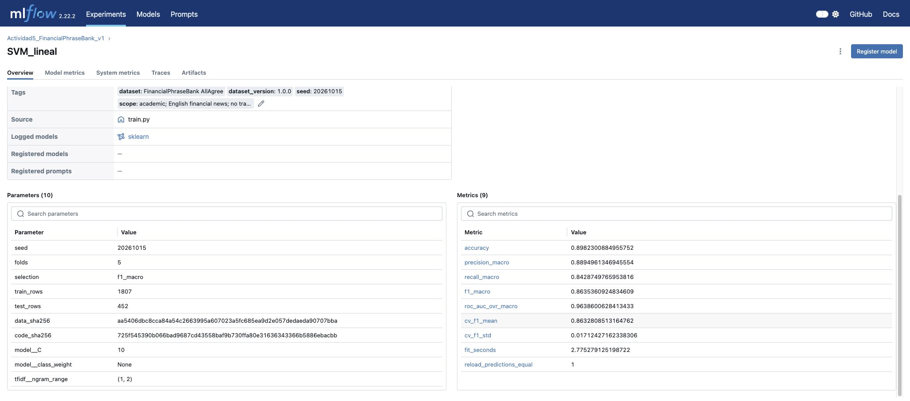
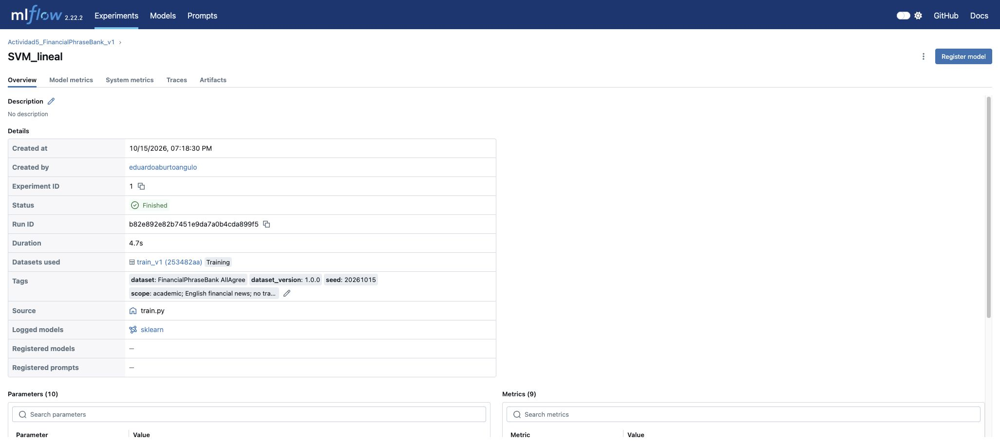

# Evidencia real de MLflow

Capturas del panel local del 15 de octubre de 2026. Las imágenes no son maquetas.
La base mlflow.db y mlartifacts conservan el seguimiento y los dos modelos.
El CSV exporta 40 corridas: 27 del entrenamiento final (24 candidatos, 2 modelos,
1 comparación) y 13 de un intento anterior que falló al registrar un ejemplo
pandas.Series. Ese fallo se corrigió usando una lista; se conserva su rastro.
La incompatibilidad inicial de SQLAlchemy ocurrió antes de crear una corrida.

Para abrir la evidencia en otro equipo, ejecuta fuentes/reubicar_mlflow.py y
mlflow ui --backend-store-uri sqlite:///mlflow.db --host 127.0.0.1 --port 5055
desde Actividad5. No reentrena ni cambia métricas.

## Capturas publicadas

### Comparación de métricas


### Detalle del modelo SVM


## Comprobar parámetros, métricas y artefactos

Desde `Actividad5`, con las dependencias instaladas:

```bash
python fuentes/verify.py
python fuentes/reubicar_mlflow.py
python fuentes/verificar_mlflow.py
mlflow ui --backend-store-uri sqlite:///mlflow.db --host 127.0.0.1 --port 5055
```

Abrir http://127.0.0.1:5055 en el mismo equipo. El [resultado de la auditoría](verificacion_mlflow.json) contrasta los dos modelos con el test y los registros reales. [Exportación de las corridas](mlflow_runs.csv). El visor de Streamlit ofrece una pestaña **MLflow · Experimentos** con parámetros y métricas consultados directamente desde SQLite, en modo de solo lectura.

Las capturas cubren la evidencia visual solicitada (video **o** capturas). No se afirma que GitHub aloje un servidor MLflow activo. Arquitectura de artefactos: [documentación oficial](https://www.mlflow.org/docs/latest/self-hosting/architecture/artifact-store/).
