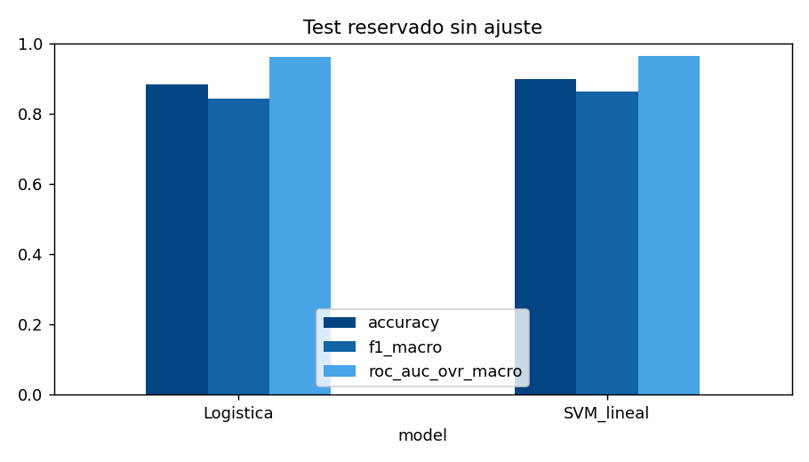

<div align="center">
  
  <h1>Asistente de revisiones de portafolio</h1>
  <p><strong>Actividad 5 · Datos, entrenamiento y trazabilidad con MLflow</strong></p>
  <p>Eduardo Aburto Angulo · Banquero Patrimonial Sr. · BBVA México</p>
  <p>Universidad Tecmilenio · Módulo 2 / Semana 6 · Temas 11 y 12</p>
  <p>
    <a href="Actividad5/documentos/Actividad5_Eduardo_Aburto.pdf"><strong>Leer reporte PDF</strong></a> ·
    <a href="https://docs.google.com/document/d/10zePpNRuSKNphrLIlZZ3mavDB5lAiLrBx5D90n2A80s/edit"><strong>Abrir Google Docs</strong></a> ·
    <a href="https://colab.research.google.com/github/eduardoaburtoa/actividad5-mlflow-portafolios/blob/main/Actividad5/fuentes/entrena.ipynb"><strong>Abrir Colab</strong></a>
  </p>
</div>

> **Mi objetivo:** preparar revisiones de portafolio mejor fundamentadas, buscando el beneficio neto del cliente y respetando su perfil de inversión. En esta etapa entrené y comparé dos modelos que clasifican noticias financieras; cada decisión técnica queda documentada en MLflow.

| Datos públicos | Entrenamiento | Evidencia | Contexto del caso |
|:---:|:---:|:---:|:---:|
| **2,259 noticias limpias** | **2 modelos · 5 folds** | **27 corridas finales** | **150 clientes ficticios** |
| 452 noticias reservadas para test | 24 configuraciones · 120 ajustes CV | Parámetros, métricas y modelos | Posiciones de $5–20 millones MXN |

## 📍 Empieza aquí

**Para revisar la entrega:** abre el reporte, consulta la matriz de la rúbrica y revisa las capturas de MLflow. Puedes hacerlo sin instalar programas.

| Quiero… | Acceso directo | Qué encontraré |
|---|---|---|
| **Leer el trabajo completo** | [Reporte PDF](Actividad5/documentos/Actividad5_Eduardo_Aburto.pdf) | Caso de uso, metodología, resultados, riesgos y conclusiones |
| **Editar el documento** | [Google Docs](https://docs.google.com/document/d/10zePpNRuSKNphrLIlZZ3mavDB5lAiLrBx5D90n2A80s/edit) · [Word](Actividad5/documentos/Actividad5_Eduardo_Aburto.docx) | Reporte con plantilla institucional, identidad Vértice y azul BBVA |
| **Revisar la rúbrica** | [Matriz de cobertura](Actividad5/REVISION_RUBRICA.md) | Los cuatro criterios y cada entregable enlazados con su evidencia |
| **Ver MLflow** | [Capturas y guía](Actividad5/evidencias/README.md) · [Auditoría ejecutada](Actividad5/evidencias/verificacion_mlflow.json) | Evidencia auténtica, comprobación de modelos y cinco métricas |
| **Consultar los resultados** | [Tabla CSV](Actividad5/resultados/comparacion.csv) · [Análisis estadístico](Actividad5/resultados/estadistica.json) | Comparación de logística y SVM, bootstrap y McNemar |
| **Ejecutar el notebook** | [Google Colab](https://colab.research.google.com/github/eduardoaburtoa/actividad5-mlflow-portafolios/blob/main/Actividad5/fuentes/entrena.ipynb) · [Archivo .ipynb](Actividad5/fuentes/entrena.ipynb) | Preparación, entrenamiento, evaluación y panel MLflow |
| **Explorar la aplicación** | [Cómo abrir Streamlit](#streamlit) · [Código](Actividad5/app.py) | Resultados, clasificación, costos y visor de experimentos |
| **Consultar los datos** | [Originales](Actividad5/datos/datos_ini/) · [Limpios](Actividad5/datos/datos_limp/) · [Diccionario](Actividad5/datos/README.md) | Fuente, campos, reglas de limpieza, licencia y versión |
| **Descargar la entrega** | [Descargar repositorio ZIP](https://github.com/eduardoaburtoa/actividad5-mlflow-portafolios/archive/refs/heads/main.zip) | Código, datos, documentos, modelos y evidencias publicados |

**Navegación:** [Caso de uso](#caso) · [Resultados](#resultados) · [MLflow](#mlflow) · [Streamlit](#streamlit) · [Reproducción](#reproducir) · [Datos](#datos) · [Rúbrica](#rubrica) · [Archivos](#archivos)

<a id="caso"></a>
## 1. El caso: mejor información antes de decidir

Como banquero, necesito llegar a cada revisión con información organizada y con una explicación clara de por qué conviene mantener o reconsiderar una posición. La propuesta está dirigida a banqueros patrimoniales, privados y corredores de bolsa. Su prioridad es el rendimiento **neto** compatible con el perfil, horizonte y liquidez del cliente.

Esta actividad desarrolla la capa de **clasificación de noticias financieras**: identifica sentimiento positivo, neutral o negativo para apoyar la lectura del asesor. No estima rendimientos futuros, selecciona fondos ni ejecuta operaciones. La simulación de costos es independiente del clasificador.

La continuidad del proyecto se organiza así:

| Etapa | Aportación |
|---|---|
| **Fase I** | Caso de negocio y criterios de beneficio neto, costos e idoneidad |
| **[Actividad 4 · Motor de señales](https://github.com/eduardoaburtoa/motor-senales-nlp)** | Comparación de modelos preentrenados de Hugging Face sobre notas sintéticas en español |
| **Actividad 5 · Este repositorio** | Datos públicos, dos modelos entrenados, ajuste con validación cruzada y trazabilidad MLflow |

No comparo directamente las métricas de las actividades 4 y 5: cambiaron los datos, el idioma y el protocolo de evaluación.

<a id="resultados"></a>
## 2. Resultados que puedo demostrar

**Seleccioné SVM lineal por F1 macro de validación cruzada.** El test se reservó para la evaluación final y no se utilizó para escoger hiperparámetros.

| Modelo | Accuracy | Precision macro | Recall macro | F1 macro | ROC-AUC macro OvR |
|---|---:|---:|---:|---:|---:|
| Regresión logística | 0.8827 | 0.8458 | 0.8387 | 0.8422 | 0.9616 |
| **SVM lineal** | **0.8982** | **0.8895** | **0.8429** | **0.8635** | **0.9639** |



**Tres hallazgos que guían mi decisión:**

1. **SVM es la referencia experimental.** Su F1 de CV es 0.8633 frente a 0.8523 de logística. La mejor configuración usa C = 10, unigramas y bigramas, sin ponderación de clases.
2. **La ventaja en test no es concluyente.** La diferencia de F1 es 0.02136; el IC 95 % del bootstrap pareado es [−0.00579, 0.04772] y McNemar arroja p = 0.1892. No afirmo superioridad estadística.
3. **El error negativo sigue siendo relevante.** SVM recupera 46 de 61 noticias negativas: recall de 0.7541. Mantengo revisión humana y no habilito movimientos automáticos.

Consulta las [métricas por clase](Actividad5/resultados/clases_SVM_lineal.csv), la [matriz de confusión](Actividad5/resultados/confusion_SVM_lineal.png) y las [condiciones de ejecución](Actividad5/resultados/entorno.json). La corrida entregada se ejecutó en **CPU local con Python 3.12**; el notebook permite reproducirla en Colab, pero no se presenta como una ejecución ya realizada allí.

<a id="mlflow"></a>
## 3. MLflow: de cada resultado a su evidencia

MLflow está integrado en el entrenamiento. Registra el dataset, su versión, hashes, semilla, parámetros, métricas, modelos y artefactos. La entrega conserva **24 candidatos, dos modelos finales y una comparación**. También mantiene 13 registros de un intento anterior, incluido su fallo, para conservar la trazabilidad.

| Evidencia | Enlace |
|---|---|
| Panel oficial: comparación de métricas | [Ver captura completa](Actividad5/evidencias/mlflow_metricas.png) |
| Panel oficial: parámetros y métricas de SVM | [Ver captura completa](Actividad5/evidencias/mlflow_svm.png) |
| Exportación de las 40 corridas conservadas | [Abrir CSV](Actividad5/evidencias/mlflow_runs.csv) |
| Base de seguimiento y artefactos | [SQLite](Actividad5/mlflow.db) · [Modelos y archivos](Actividad5/mlartifacts/) |
| Verificación de métricas y recarga | [Resultado de auditoría](Actividad5/evidencias/verificacion_mlflow.json) · [Script](Actividad5/fuentes/verificar_mlflow.py) |
| Abrir el panel en otro equipo | [Guía paso a paso](Actividad5/evidencias/README.md) |


<details>
<summary><strong>Ver los identificadores de las corridas finales</strong></summary>

| Modelo | Run ID |
|---|---|
| Regresión logística | `d6b1e315b58e46bf9b7f467eec70beaf` |
| SVM lineal | `b82e892e82b7451e9da7a0b4cda899f5` |

El verificador recarga ambos modelos con MLflow, reproduce sus predicciones y recalcula accuracy, precision, recall, F1 y ROC-AUC. Contrasta los resultados con los CSV y la base SQLite. El [código original](Actividad5/fuentes/historico/train_20261015.py) permite comprobar el hash de la corrida histórica.

</details>

<a id="streamlit"></a>
## 4. Streamlit: explorar la actividad

La aplicación reúne cuatro espacios:

| Pestaña | Para qué sirve |
|---|---|
| **Resultados y evidencia** | Comparar modelos, consultar gráficos y descargar el reporte |
| **Clasificar una noticia** | Probar el modelo SVM con una noticia pública en inglés |
| **Simulación de costos** | Explorar escenarios con los 150 clientes ficticios |
| **MLflow · Experimentos** | Consultar las corridas, parámetros y métricas reales de SQLite |

**Estado:** código publicado y probado localmente. Todavía no hay una aplicación alojada en una URL pública. El visor de experimentos consulta registros reales, pero no sustituye al panel oficial de MLflow.

Para abrirla, usa Python 3.12 y ejecuta desde una terminal:

```bash
git clone https://github.com/eduardoaburtoa/actividad5-mlflow-portafolios.git
cd actividad5-mlflow-portafolios
python -m venv .venv
```

Activa el entorno con `source .venv/bin/activate` en macOS/Linux o `.venv\Scripts\Activate.ps1` en PowerShell. Después:

```bash
python -m pip install -r requirements.txt
streamlit run streamlit_app.py
```

Abre la dirección local que muestre Streamlit, normalmente `http://localhost:8501`.

<a id="reproducir"></a>
## 5. Reproducir y revisar sin perder la evidencia

### Ruta A · Notebook en Google Colab

[**Abrir el notebook en Colab**](https://colab.research.google.com/github/eduardoaburtoa/actividad5-mlflow-portafolios/blob/main/Actividad5/fuentes/entrena.ipynb). Ejecuta las celdas en orden. No requiere GPU. El cuaderno instala dependencias, verifica los datos y la evidencia, entrena los dos modelos, presenta resultados y permite abrir MLflow mediante el proxy de Colab.

Cada entrenamiento genera nuevas corridas. Conserva el repositorio original si necesitas comparar con la entrega histórica.

### Ruta B · Consultar la evidencia local, sin reentrenar

Desde la raíz del repositorio clonado y con el entorno de Python activado:

```bash
cd Actividad5
python -m pip install -r requirements.txt
python fuentes/verify.py
python fuentes/reubicar_mlflow.py
python fuentes/verificar_mlflow.py
mlflow ui --backend-store-uri sqlite:///mlflow.db --host 127.0.0.1 --port 5055
```

Abre `http://127.0.0.1:5055`. La reubicación adapta las rutas de artefactos al equipo actual y conserva métricas y parámetros. **GitHub almacena los archivos; el servidor MLflow se ejecuta en tu equipo.**

### Ruta C · Entrenar una nueva corrida

En una copia del proyecto, con las dependencias completas instaladas y desde `Actividad5`:

```bash
python fuentes/train.py
```

La ejecución crea nuevos IDs de MLflow y reemplaza los CSV y gráficos de esa copia. El entrenamiento local corrige las rutas de artefactos antes de iniciar. La guía de [reproducción técnica](Actividad5/README.md) explica versiones, decisiones y límites.

<a id="datos"></a>
## 6. Datos públicos y clientes ficticios

| Conjunto | Naturaleza y uso | Acceso |
|---|---|---|
| Financial PhraseBank AllAgree | Noticias financieras públicas en inglés; dataset de entrenamiento y evaluación | [Original](Actividad5/datos/datos_ini/) · [Limpio](Actividad5/datos/datos_limp/phrasebank_v1.csv) |
| Cartera de 150 clientes | Superhéroes y villanos ficticios; contexto didáctico, posiciones de $5–20 millones MXN | [Clientes simulados](Actividad5/contexto/clientes_simulados.csv) |
| Fondos y comisiones BBVA | Información pública de contexto; 61 fichas consultadas el 15/10/2026 y 693 registros de gastos por serie | [Índice de fichas](Actividad5/contexto/fichas_bbva.csv) · [Comisiones por serie](Actividad5/contexto/comisiones_por_serie.csv) |

Uso personajes ficticios para representar personalidades y perfiles sin publicar información de clientes reales. La cartera y las comisiones **no forman parte del entrenamiento del clasificador**.

La preparación conserva 2,264 noticias originales y elimina cinco duplicados. La partición final contiene 1,807 noticias de entrenamiento y 452 de test, con semilla 20261015. Los [campos y reglas](Actividad5/datos/README.md), [hashes](Actividad5/datos/manifest.json) y [gráfico de calidad](Actividad5/resultados/calidad_datos.png) permiten revisar el proceso.

### Criterio de negocio

El 1 % de corretaje por venta y el 1 % por compra son **supuestos didácticos**, no una tarifa general BBVA verificada. El análisis debe considerar beneficio neto, perfil, horizonte, liquidez y costos antes de proponer un movimiento. No resto nuevamente comisiones ya incorporadas en rendimientos netos ni equiparo todos los gastos de un fondo con ingresos del banco.

<a id="rubrica"></a>
## 7. Entrega y rúbrica: dónde revisar cada criterio

| Criterio | Peso | Evidencia principal |
|---|---:|---|
| Gestión y preparación de datos | 25 % | [Datos y diccionario](Actividad5/datos/README.md), [limpieza](Actividad5/fuentes/datos_prep.py), [calidad](Actividad5/resultados/calidad_datos.png) |
| Entrenamiento y ajuste | 25 % | [Entrenamiento](Actividad5/fuentes/train.py), [Grid Search logística](Actividad5/resultados/grid_Logistica.csv), [Grid Search SVM](Actividad5/resultados/grid_SVM_lineal.csv) |
| Registro y reproducibilidad con MLflow | 25 % | [Evidencias](Actividad5/evidencias/README.md), [verificación ejecutada](Actividad5/evidencias/verificacion_mlflow.json), [notebook](Actividad5/fuentes/entrena.ipynb) |
| Comparación e interpretación técnica | 25 % | [Reporte](Actividad5/documentos/Actividad5_Eduardo_Aburto.pdf), [estadística](Actividad5/resultados/estadistica.json), [conclusiones y MLOps](Actividad5/README.md#mlops-pendiente) |

La [matriz completa](Actividad5/REVISION_RUBRICA.md) enlaza todos los entregables. Se publican capturas auténticas para cubrir la evidencia visual solicitada: la consigna admite **video o capturas**. La calificación corresponde al docente.

<a id="archivos"></a>
## 8. Mapa del repositorio

```text
actividad5-mlflow-portafolios/
├── README.md                    Portada y accesos directos
├── streamlit_app.py              Entrada de la aplicación
├── requirements.txt             Dependencias de Streamlit
├── .streamlit/                   Tema visual azul
└── Actividad5/
    ├── datos/
    │   ├── datos_ini/           Datos originales y licencia
    │   ├── datos_limp/          Dataset limpio y partición
    │   └── manifest.json        Hashes, conteos y semilla
    ├── fuentes/                 Limpieza, entrenamiento y verificadores
    │   ├── entrena.ipynb        Notebook para Colab
    │   └── historico/           Código de la corrida original
    ├── resultados/              Métricas, gráficos y estadística
    ├── evidencias/              Capturas y auditoría de MLflow
    ├── mlflow.db                Base de seguimiento
    ├── mlartifacts/             Modelos y artefactos registrados
    ├── documentos/              Reporte PDF, Word y logotipo
    ├── contexto/                Clientes ficticios y fichas públicas
    ├── app.py                  Aplicación Streamlit
    ├── requirements.txt        Dependencias del entrenamiento
    ├── README.md               Guía técnica detallada
    ├── REVISION_RUBRICA.md      Matriz de cumplimiento
    └── CHANGELOG.md            Historial y decisiones
```

## 9. Mi conclusión y siguientes pasos

Conservo SVM como referencia experimental porque fue seleccionada con un criterio definido y puedo rastrear sus resultados hasta los datos y el código. Antes de un piloto patrimonial, necesito validar un corpus en español mexicano, revisar derechos comerciales, evaluar noticias relacionadas y cambios temporales, y mejorar la recuperación de noticias negativas. La aprobación del asesor y la compatibilidad del perfil siguen siendo necesarias.

[Historial de cambios](Actividad5/CHANGELOG.md) · [Metodología completa](Actividad5/README.md) · [Actividad anterior](https://github.com/eduardoaburtoa/motor-senales-nlp)

**Licencias:** código propio [MIT](Actividad5/LICENSE). Financial PhraseBank y sus derivados: [CC BY-NC-SA 3.0](Actividad5/datos/datos_ini/License.txt), con atribución a sus autores y uso académico no comercial. Las marcas y materiales institucionales conservan sus derechos.

*Ejercicio académico de Eduardo Aburto Angulo. No es un producto oficial de BBVA ni una recomendación personalizada de inversión.*
